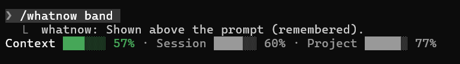
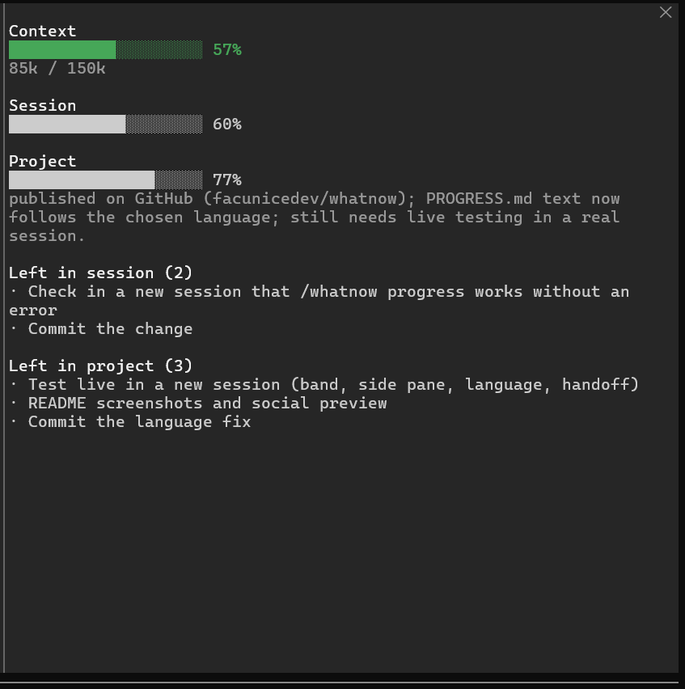

# whatnow

[](LICENSE)

**A panel for Claude Code that answers "where am I?"** It shows how full the context is, how far along the current session is, how far along the whole project is, and what is still left. When the context fills up, it asks Claude to write a handoff so you can continue in a fresh session.

> Early version (0.2). Works in the author's setup; feedback from real sessions is welcome.

## What you see

One line above the prompt (`/whatnow band`):



Or a side pane with the lists of what is left (`/whatnow side`):



- **Context**: tokens used against a limit you choose (default 150k = 100%).
- **Session**: % of the checklist under `## This session` in `PROGRESS.md`.
- **Project**: % of the rest of the checklist in `PROGRESS.md`.
- **Left**: the unchecked items of each list (side pane).

## Install

whatnow is a Claude Code mod. Copy this folder into your mods directory:

```bash
git clone https://github.com/facunicedev/whatnow.git ~/.claude/mods/whatnow
```

Restart Claude Code. Check it with `claude plugin validate ~/.claude/mods/whatnow`.

## Usage

Keep a `PROGRESS.md` in your project with checkboxes (Claude keeps it up to date for you):

```md
# My project
Status: one sentence on how it is going

- [x] Done thing
- [ ] Pending thing

## This session
- [x] Step one
- [ ] Step two
```

| Command | What it does |
|---|---|
| `/whatnow` | show or hide the panel |
| `/whatnow side` | put it in a side pane (falls back to the band if the window is narrow) |
| `/whatnow band` | one line above the prompt |
| `/whatnow limit 120k` | tokens at which the handoff is requested |
| `/whatnow progress` | Claude updates `PROGRESS.md` now |
| `/whatnow handoff` | Claude writes the handoff now |
| `/whatnow en`, `/whatnow es`, `/whatnow auto` | change language (any `lang/<code>.json` works as `/whatnow <code>`) |
| `/whatnow help` | list commands |

The handoff goes to `.claude/HANDOFF.md` and is offered to the next session you open in that folder. Tip: open Claude Code inside the project folder, not a parent folder, so these files land in the right place. Adding `PROGRESS.md` and `.claude/` to your `.gitignore` keeps them private.

## Languages

English and Spanish included; `auto` follows Claude Code's language setting, then your system language. When you switch language, `PROGRESS.md` is translated too (one small model call, the file is left alone if the translation looks wrong). To add one, copy `lang/en.json` to `lang/<code>.json` and translate it.

## Development

```bash
claude plugin test .
claude plugin validate .
```

See [CONTRIBUTING.md](CONTRIBUTING.md). Licensed under [MIT](LICENSE).
